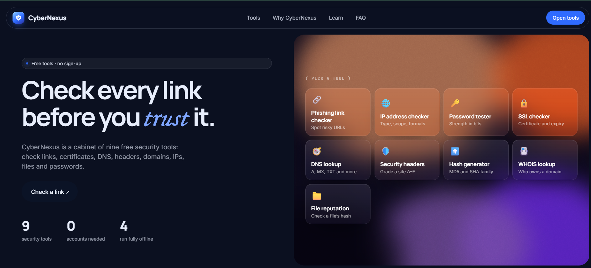
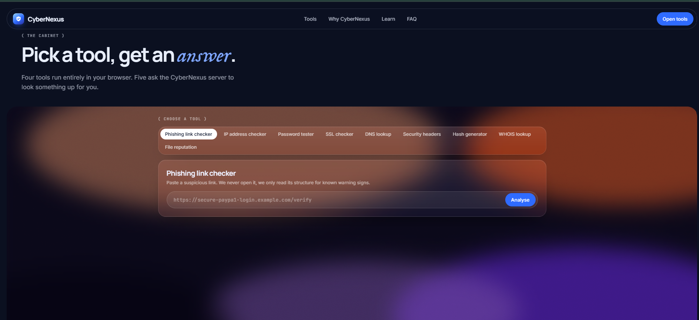
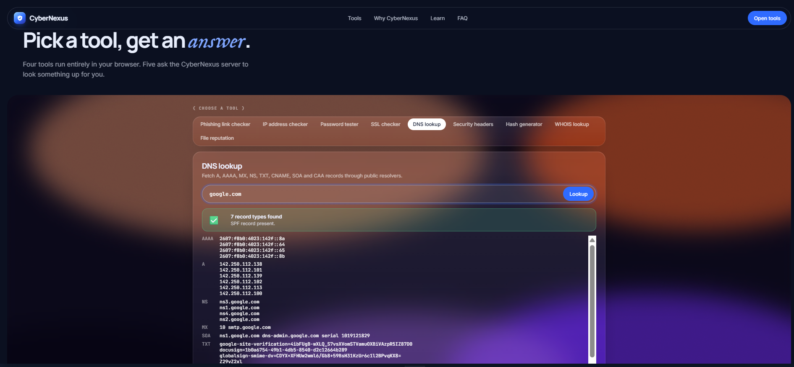
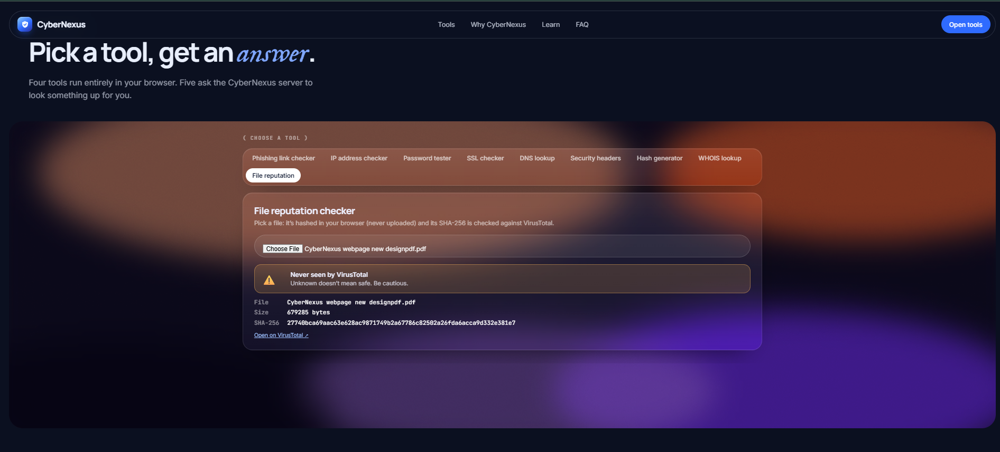

# 🛡️ CyberNexus

### Free Cybersecurity Tools — All in One Place

CyberNexus is a web-based cybersecurity toolkit that brings together essential security and network utilities in one simple interface. It combines browser-based checks with server-powered tools to make basic security testing accessible and convenient.

🌐 **Live Demo:** [https://cybernexus-ngea.onrender.com/](https://cybernexus-ngea.onrender.com/)

## ✨ Features

CyberNexus currently provides 9 tools:

| Tool | Description |
|---|---|
| 🔗 Phishing Link Checker | Checks URLs for suspicious patterns |
| 🌐 IP Address Checker | Provides information about IP addresses |
| 🔐 Password Strength Tester | Evaluates password strength |
| 🛡️ SSL Checker | Retrieves SSL/TLS certificate information |
| 🔎 DNS Lookup | Looks up DNS records such as A, AAAA, MX, NS and TXT |
| 📋 Security Headers Checker | Inspects HTTP security headers |
| #️⃣ Hash Generator | Generates cryptographic hashes |
| 🗂️ WHOIS Lookup | Retrieves domain/IP registration information through RDAP |
| 📁 File Reputation Checker | Calculates SHA-256 hashes in the browser and checks them against VirusTotal |

## 🚀 Live Demo

Try CyberNexus here:

[**https://cybernexus-ngea.onrender.com/**](https://cybernexus-ngea.onrender.com/)

## 🧰 Tech Stack

- **Frontend:** HTML, CSS, JavaScript
- **Backend:** Node.js
- **Networking:** DNS, RDAP, HTTP requests
- **Security Analysis:** VirusTotal API
- **Deployment:** Render

## 📂 Project Structure

```text
CyberNexus/
├── Public/
│   ├── index.html
│   ├── style.css
│   └── script.js
├── package.json
├── server.js
├── .gitignore
└── README.md
```
## 📸 Screenshots

### Homepage


### Cybersecurity Tools


### DNS Lookup


### File Reputation Checker



## ⚙️ Installation & Setup

### Prerequisites

- Node.js 18 or later
- Git

### 1. Clone the repository

```bash
git clone https://github.com/Suparno08/CyberNexus.git
```

### 2. Navigate to the project directory

```bash
cd CyberNexus
```

### 3. Install dependencies

```bash
npm install
```

### 4. Start the server

```bash
npm start
```

### 5. Open in your browser

```text
http://localhost:3000
```

## 🔑 VirusTotal API Configuration

The File Reputation Checker can use the VirusTotal API for automatic file hash reputation results.

To enable it:

1. Create an account at [VirusTotal](https://www.virustotal.com/).
2. Obtain your API key from your VirusTotal profile.
3. Set the API key as an environment variable named `VT_API_KEY`.

For Windows PowerShell:

```powershell
$env:VT_API_KEY="YOUR_VIRUSTOTAL_API_KEY"
npm start
```

For Render deployment, add `VT_API_KEY` under your service's Environment Variables.

**Important:** Never expose your API key in frontend JavaScript or commit it to GitHub.

## 🔒 Privacy & Security

- File hashing is performed in the browser.
- The selected file is not uploaded for hash generation or reputation lookup.
- Only the SHA-256 hash is sent to the backend for VirusTotal checking.
- API keys are stored as server-side environment variables.
- Network-related requests are handled by the backend.

## 🛠️ Future Improvements

- More cybersecurity utilities
- Improved error handling and validation
- Enhanced mobile responsiveness
- Better security analysis and reporting
- Improved user experience and accessibility

## 🤝 Contributing

Contributions, suggestions and bug reports are welcome.

1. Fork the repository.
2. Create a new branch.
3. Make your changes.
4. Submit a pull request.

## 👥 Team PixelBits

CyberNexus is developed by **Team PixelBits**.

### Team Members

1. Suparno Das
2. Patanjali Haldar
3. Alekhya Mondal
4. Supradip Paul
5. Raj Kumar Das

## 👨‍💻 Author & Project Maintainer

**Suparno Das**

- GitHub: [@Suparno08](https://github.com/Suparno08)

---

**CyberNexus — Explore. Analyze. Secure.**

*Built with ❤️ by Team PixelBits.*
